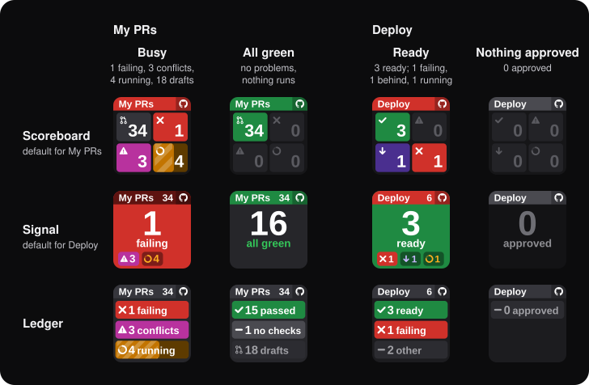

# GitHub PR Vitals for Stream Deck

Your open GitHub pull requests, live on your Stream Deck. Each key is one pull request, with its pipeline, its review
and its Jira ticket, so you can see what needs you without opening a browser tab.

  

- **See what needs you.** Failed checks, conflicts, requested changes and pull requests that are ready to deploy each
  have their own look.
- **Press once** to open the pull request. Press again within 3 seconds to open its Jira ticket.
- **Nothing to arrange.** The keys fill themselves, newest pull request first.
- **Read-only.** The plugin never writes to GitHub or Jira.

## Reading a PR key

The band at the top is the pipeline. The background is the review. A white tick means that the Jira ticket is resolved.

### All the faces

A key can also report a problem, such as an expired token. [Troubleshooting](docs/troubleshooting.md) shows those
faces.

## Summary keys

**My PRs** and **Deploy** sit on your own profile and count what needs attention. Press one and the deck switches to
its list. **Back** returns you to your profile.

**Deploy** lists your approved pull requests. The ones that are ready to deploy come first.

Each key comes in three styles. Pick one in the settings.
[What each count means](docs/how-it-works.md#summary-keys).

## Install

You need Stream Deck 7.1 or later, on Windows 10 or later, or on macOS 13 or later. Profiles are included for the
XL, the MK.2 and other 15-key decks, the Mini, the Neo and the Plus.

1. Download `com.nocture.prvitals.streamDeckPlugin` from the
   [latest release](https://github.com/Nocture/github-pr-vitals/releases/latest).
2. Double-click the file and accept.

To update, do the same with a newer file.

## Setup

1. Drag **My PRs** and **Deploy** from the **GitHub PR Vitals** category onto a page of your profile.
2. Open the settings of either key and follow the link under **GitHub token**. GitHub opens with the right scopes
   ticked. Generate the token, paste it and press **Test**.
3. Press **My PRs**. Stream Deck asks once to install the **PR Vitals** profile. Accept. Press **Back**, then do
   the same with **Deploy**.

If your organisation uses single sign-on, or you want the Jira tick, see [Tokens](docs/tokens.md).

## Settings

Every key opens the same settings page, and the settings apply to all keys.

| Setting | What it does |
| --- | --- |
| **GitHub token** | Reads your pull requests. **Test** shows your login. |
| **Jira site**, **Jira projects** | Optional. A key shows its ticket instead of the PR number, and a second press opens the ticket. |
| **Jira email**, **Jira token** | Optional. Adds the white tick for resolved tickets. |
| **Repo colours** | One colour per repository. Pick your own. |
| **Show PRs in** | The organisations whose pull requests you want to see. Your own account starts unticked. |
| **My PRs style**, **Deploy style** | Scoreboard, Signal or Ledger. |

## More

- [Tokens](docs/tokens.md): both tokens step by step, and what each scope reads.
- [Troubleshooting](docs/troubleshooting.md): what a problem looks like on the keys, and where the log is.
- [How it works](docs/how-it-works.md): the exact rules for the key order, the counts and the Deploy list.
- [Development](docs/development.md): build, test and package.

## License

MIT. See [LICENSE](LICENSE). Third-party material has its own licenses: see
[THIRD-PARTY-NOTICES.txt](com.nocture.prvitals.sdPlugin/THIRD-PARTY-NOTICES.txt). The packaged plugin also has
`bin/THIRD-PARTY-NOTICES.txt`, for the packages inside `bin/plugin.js`.
