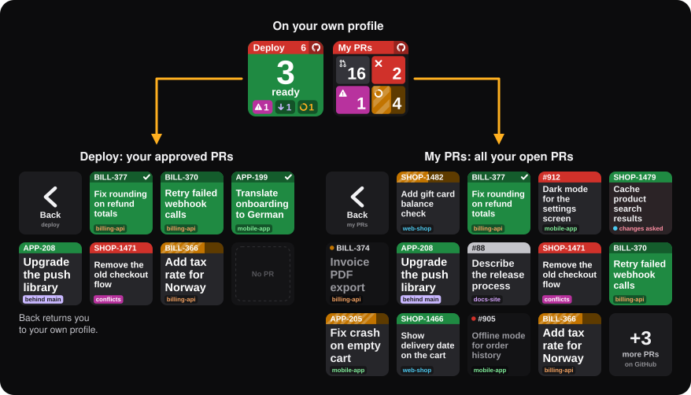
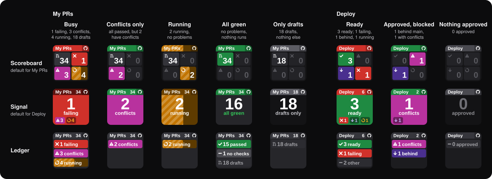
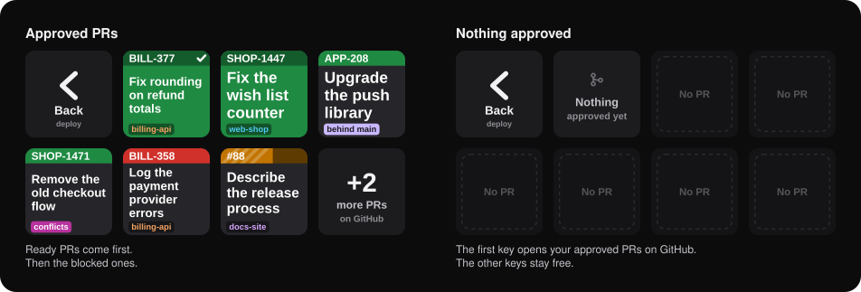

# How it works

The exact rules of the plugin. Back to the [README](../README.md).

## The five keys

You find the keys in the **GitHub PR Vitals** category of the action list.

| Key | What it shows | Press |
| --- | --- | --- |
| **PR slot** | One of your open pull requests | Opens the pull request on GitHub |
| **Deploy slot** | One of your approved pull requests | Opens the pull request on GitHub |
| **My PRs** | Counts of your open pull requests | Switches the deck to the **PR Vitals** profile |
| **Deploy** | Counts of your approved pull requests | Switches the deck to the **PR Deploy** profile |
| **Back** | "Back", and the list that the deck shows | Returns to the profile that you came from |

- A slot key has no settings of its own.
- The plugin comes with two profiles. **PR Vitals** has a Back key and PR slots. **PR Deploy** has a Back key and
  Deploy slots. The Back key is at the top left. Slot keys fill the other keys. On a Plus, the dials do nothing.
- You can also put PR slot and Deploy slot keys on your own pages.

## The order of the keys

- The slots are ordered by row, then by column. With slots on more than one deck, the order goes deck by deck.
- The newest created pull request goes to the first slot. The next one goes to the slot on its right, and so on,
  row by row.
- If there are more pull requests than slots, the last key counts the rest. Press it to open the list on GitHub.
  A PR slot opens your open pull requests. A Deploy slot opens your approved pull requests.
- Free slots show "No PR".
- A slot key does not work inside a multi-action.

## The band

- A failed pipeline pulses red for 5 minutes after it turns red. Then the red stays still.
- A draft has no band. A dot before the ticket has the colour of the pipeline. Without checks, the dot is a grey
  ring.

## The ticket

- The band shows the Jira ticket from the start of the title. Without one there, it takes the ticket from the
  start of the branch name.
- Only the projects in **Jira projects** count as tickets, so "UTF-8" in a title is not one.
- A pull request without a ticket shows its number, such as `#4521`, and has no tick.
- The white tick means that the Jira status of the ticket is in the "Done" category.

## The bottom line

The bottom line shows the name of the repository, in its colour. A problem or a notice takes its place:

- "changes asked": a reviewer asked for changes.
- "behind main": the pull request is approved, but behind its base branch. The name of the base branch comes
  after "behind".
- "conflicts": the pull request cannot merge into its base. This shows before the approval too, but not on a
  draft.
- "offline 4m" or "paused to 14:05": the data is old. See [Troubleshooting](troubleshooting.md).

The words "conflicts" and "behind main" flash, so that you can see which pull requests need action. The flash
never stops.

## The second press

A press opens the pull request. Then the key turns Jira blue for 3 seconds. It says "Press again to open JIRA" and
counts down: "3s", "2s", "1s". A second press in that time opens the Jira ticket. After that, the key shows the
pull request again.

Without a ticket, the key is grey and says "No JIRA ticket". Without a Jira site, the key is grey and says "Set
the JIRA site". In these two cases, the second press opens nothing.

## Summary keys

- **Signal**: the whole key takes the colour of the first problem, and the big number counts it. Chips at the
  bottom count the other problems. Without a problem, My PRs is grey and says "all green". With only drafts, it
  is black and says "drafts only". Deploy is green while a pull request is ready. Then the big number counts the
  ready pull requests, and the chips count every problem.
- **Scoreboard**: four tiles. My PRs shows the total, failing, conflicts and running. Deploy shows ready,
  conflicts, behind, and failing or running. A tile with 0 is dark. The total is always lit.
- **Ledger**: up to three rows, one count per row. My PRs lists its problems. Without a problem, it lists passed,
  no checks and drafts. Deploy lists ready first, then its problems. With more than three, the last row says
  "N other".

What the counts mean:

- **My PRs** counts every open pull request in its total, drafts included. Signal and Ledger show the total in the
  band. Scoreboard shows it in the first tile.
- Failing, running, passed and no checks count only the pull requests that are not drafts.
- Conflicts counts the pull requests that are not drafts and cannot merge into their base.
- A draft never counts as a problem.
- **Deploy** counts the pull requests of the [Deploy list](#the-deploy-list). Signal and Ledger show their number
  in the band. Each one counts once, in the first group that fits: conflicts, failing, behind, running, ready, no
  checks.
- In Signal and Ledger, when nothing is approved, Deploy says "0 approved".

The problems, most urgent first:

- My PRs: failing, conflicts, running.
- Deploy: failing, conflicts, behind, running, no checks.

In Signal and Scoreboard, the band at the top shows the worst pipeline of the counted pull requests. In Ledger, the
band is grey. Failing blinks red for as long as a counted pull request fails. Running is amber with moving stripes.
The amber part shows how far the checks are.

The signs are the same in every style: × failing, a triangle with "!" for conflicts, a ring for running, a tick
for passed or ready, a dash for no checks, a down arrow for behind, and a pull request sign for totals and drafts.

## The Deploy list

The Deploy list holds your open pull requests that are approved and that merge into the default branch of their
repository.

- **Approved** means GitHub's review decision is "approved". It includes approved pull requests that are behind
  their base or that have conflicts.
- **Ready** means approved, up to date, without conflicts, and with a passed pipeline. Only a ready pull request
  has the green background. The Jira status does not count, because the ticket usually moves on after the merge.
- Ready pull requests come first. The others follow. In each group, the newest created pull request comes first.
- Stacked pull requests are left out. Their base is another feature branch, so their merge deploys nothing.
- The plugin reads the default branch of a repository once, over GitHub's REST API. When the plugin cannot read
  it, `main` and `master` count as default branches. The plugin tries again after an hour.
- With no approved pull request, the first Deploy slot says "Nothing approved yet". Press it to open your approved
  pull requests on GitHub. While the data is old, for example offline, the key says "No data" instead.
- The rules for "ready" and for stacked pull requests are fixed. They are not settings.

## When it updates

- The plugin asks GitHub every 60 seconds. Each update is one GraphQL query.
- It asks Jira every 5 minutes, with one call for all the tickets on the keys. A ticket that is new on the keys is
  asked for sooner.
- It asks only while a key that needs data is on screen. A Back key alone does not count.
- It asks at once when Stream Deck starts, after the computer wakes up, and when the first key appears. It also
  asks at once when you change the token or **Show PRs in**.
