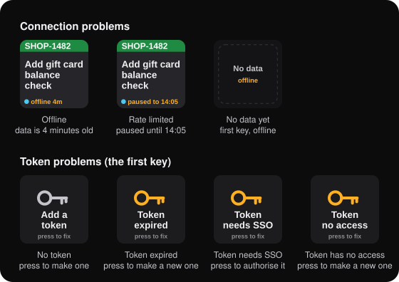

# Troubleshooting

A slot key that reports a problem looks like one of these. Back to the [README](../README.md).

| What you see | Why | What to do |
| --- | --- | --- |
| "Add a token" | The settings have no token | Press the key. It opens GitHub's page for a new token, with the scopes ticked. Make a token |
| "Token expired" | GitHub refused the token (HTTP 401). It expired, or it was deleted | Press the key. It opens the same page. Make a new token |
| "Token needs SSO" | The organisation uses SAML single sign-on, and the token is not authorised for it | Press the key. It opens the token list. Authorise the token there: see step 6 of [The GitHub token](tokens.md#the-github-token) |
| "Token no access" | GitHub refused the data. The token lacks a scope, or the organisation does not allow it | Make a token with the scopes of [The GitHub token](tokens.md#the-github-token) |
| "offline 4m" on the bottom line of the PR keys, or a dimmed summary key with a strip that says "offline 4m" | The last call to GitHub failed, for example without a network. The time is the age of the data | Nothing. The keys keep the last data. The notice goes away with the next answer |
| "paused to 14:05" on the bottom line of the PR keys, or a dimmed summary key with a pause sign and "until 14:05" | GitHub's rate limit. GitHub allows calls again at that time | Nothing. The keys keep the last data. The plugin waits until that time |
| "No data" on the first slot key, with "offline" or "paused to 14:05" | GitHub has not answered since Stream Deck started | Nothing. The other slots stay free until the first answer |
| "Loading" with three dots on a summary key | The plugin waits for the first answer | Nothing. The counts show after the first answer |

The token faces show on the first slot key and on the summary keys.

## Every slot shows "No PR"

The token sees none of your pull requests. Check that the token has the `repo` scope. Then check **Show PRs in**
in the [settings](../README.md#settings).

## A press on My PRs or Deploy does nothing

Some decks have no bundled profile: Mobile, Studio, Stream Deck + XL and Virtual. On these, a press only writes a
line in the log.

## The Jira tick

- While a Jira field is empty, no key shows a tick, and the settings say "Jira: off".
- When Jira refuses the token, for example after it expired, every tick goes. **Test** says "Jira refused the
  token." Make a new one: see [The Jira token](tokens.md#the-jira-token).
- When Jira fails in another way, the ticks keep the last status for up to 15 minutes.

The rest of the plugin works as usual without Jira.

## The Status section

The settings page has four sections: GitHub, Jira, Display and Status. The **Status** section has two lines:

- **Updated**: the time of the last answer from each service, such as `GitHub 14:03 · every 60 s` and
  `Jira 14:01 · every 5 min`. It says "not yet" before the first answer.
- **Build**: the git tag or commit of the plugin, and the time of the build.

## The log

The plugin writes a log in the `logs` folder of its plugin folder:

- Windows: `%APPDATA%\Elgato\StreamDeck\Plugins\com.nocture.prvitals.sdPlugin\logs\`
- macOS: `~/Library/Application Support/com.elgato.StreamDeck/Plugins/com.nocture.prvitals.sdPlugin/logs/`

The plugin never writes a token to the log.
